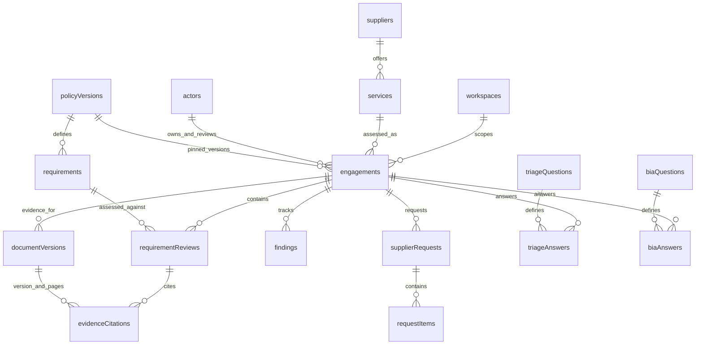

# Demo data model

The demo now separates record data from its schema. `public/data/workspace.json` has 133 synthetic records in 19 collections. `public/schemas/workspace.schema.json` describes them using JSON Schema Draft 2020-12. `src/data-model.mjs` validates records and joins them into the existing screen format. The migration was compared with the original complete JSON projection: all original values and row ordering match.

Two customer identities are seeded: `customer-morgan` for Northstar Payments and `customer-singh` for Ridgeway Finance. Each remains restricted to one workspace. Ridgeway's Clearbridge Data and Kite Legal records use T. Singh as their customer Decision Owner and remain portfolio previews. Derived `workspaceProfiles` keep customer names, initials, decision owners and pinned policy metadata separate; an absent overlay or case reviewer stays unconfigured rather than inheriting Northstar's prepared walkthrough values.

## Relationships



| Collection | Meaning and important fields |
| --- | --- |
| workspaces | Customer organizations. Northstar and Ridgeway stay distinct. |
| actors | Synthetic named identities, separate from user-role/access records. |
| users | Actor, email, customer/analyst/superadmin role, active status and independent QA permission. Customer users have one workspace; internal users have no single workspace. These simulate users, not real authentication. |
| customerAssignments | Explicit analyst-to-customer links, unique per analyst/customer. Superadmin manages these in Team & access. |
| policyVersions | Explicit `core`, `plan` and customer `overlay` version kinds. The two Enhanced v3 labels are separate plan/overlay records. These are fixture version pins, not the approved methodology content. |
| suppliers | Supplier identity and optional known domain/country; no supplier-wide risk. Unknown metadata is `null`. `intakeEnabled` controls inclusion in the demo suggestion list. |
| services | Supplier-owned service scopes. Optional `suggestionOrder` identifies the prepared intake suggestions. |
| engagements | Customer + service scope, owner, analyst/QA/decision-owner references, stage, due date and policy pins. Risk belongs to this scoped assessment, with explicit synthetic/awaiting-triage basis. One assessment per engagement is sufficient for this prototype. |
| requirements | Version-pinned requirement definitions, separate from conclusions. |
| requirementReviews | A requirement's conclusion in one engagement, prepared source explanation and illustrative proposal. These are not signed analyst audit records. |
| documentVersions | Exact file version metadata, logical `documentKey`, engagement/requirement scope, receipt date and page count. No file contents are stored. |
| evidenceCitations | A review's document version and page range. An unavailable excerpt is `null`, not invented. |
| findings | Scoped issue, requirement, owner, severity, state and deadline. Fixture “Open condition” is an illustrative finding state; it is not proof of a recorded customer decision. |
| triageQuestions / triageAnswers | Question definitions separate from engagement-specific boolean answers. |
| biaQuestions / biaAnswers | Fixture question definitions separate from impact answers. `canonicalCode` is deliberately `null`: mapping these labels to the approved CTP questionnaire needs confirmation. |
| supplierRequests / requestItems | Scoped local request packet, recipient/deadline and ordered requirement-linked requested items. No outbound delivery is implied. |

Every row has an immutable-in-editor string `id`. References use IDs, not display names. Dates are `YYYY-MM-DD`; timestamps in frozen examples use ISO datetime strings. Nullable fields are explicitly present as `null`. IDs remain compatible with the original walkthrough (`cedar`, `R-07`, etc.).

## Schema and validation

The schema is the single definition of field types, allowed enums and required columns. Two small annotations supply the relational information that JSON Schema does not express by itself:

- `x-references: "suppliers"` means the field references that collection's `id`.
- `x-unique: [["engagementId", "requirementId"]]` declares a composite unique key.

Ajv validates structure, formats and enums on initial load and before every editor mutation. The same module checks unique IDs/composite keys, existing references, policy kinds, analyst/QA separation, requirement/core-version agreement, citation scope and page bounds. Changes are immutable and atomic: an invalid save leaves the previous dataset intact. Deletion restricts references; it never silently cascades. The CedarCloud walkthrough needs four reviews and its two ordered request items, so those slots cannot be removed until the screen logic is generalized.

Schema background: [JSON Schema structure and reuse](https://json-schema.org/understanding-json-schema/structuring), [Ajv JSON Schema support](https://ajv.js.org/json-schema.html).

## Derive database models

```sh
npm run generate:db
npm run validate:data
```

`scripts/database.mjs` derives these committed references from the schema and data:

- `database/schema.sql`: PostgreSQL tables, primary/foreign keys, restricted deletes, composite uniqueness, scalar checks and selected row-level business checks.
- `database/seed.sql`: all synthetic records in dependency order, using escaped SQL literals.

Use a fresh disposable PostgreSQL database for these reference files. They are creation scripts, not incremental migrations, and must not be applied to an existing production database. A later backend/ORM can map each collection to a model using the same fields and relationships. Other database engines need their own type/DDL mapping.

The build validates the data and checks that generated SQL exactly matches its sources. SQL generation is tested; no database service is required or started by the demo. JSON formats and cross-record checks (policy kinds, citation scope/page count, pinned walkthrough constraints) still need server-side enforcement in a real backend. Generated SQL is a starting point, not a complete production invariant/security layer.

## Session editing

Choose **Superadmin** in the demo-user selector, then open **Demo data** in the bottom toolbar. Users and customer assignments are managed through the dedicated Team & access page. Pick a collection, choose a row to edit, or select **Add record**. Reference fields offer existing records; delete requires confirmation. Create referenced parents first and delete dependants first. Save errors explain invalid values or missing dependencies. **Download data JSON** exports the current normalized base dataset, without changing files on disk.

Records and existing workflow changes live in React memory. Navigation and perspective switches preserve them; refresh restores the source fixtures. No localStorage or sessionStorage is used for demo state. Older browser-saved data is ignored, not deleted. **Reset demo** clears workflow progress/overrides but retains edits to the base records until refresh. Downloading is the only way to keep edited fixture records beyond the current page session.

## Scope and remaining boundaries

`presentation.json` holds scenario/display settings, seed workflow state and static illustrative panels such as historical communications, monitoring cards and policy previews. Those panels remain reference illustrations; they are not synchronized database queries. Core registers, requirements, documents, findings and intake suggestions come from the normalized records. `examples.json` deliberately retains frozen historical display snapshots rather than joining mutable current records into them.

Existing intake submissions, uploads, QA actions, decisions, conditions and receipts continue in the existing workflow state machine (`src/state.mjs` and `src/main.jsx`). They persist for this page session, and signed packs retain their separate JSON download. They are not yet round-tripped into the normalized fixture collections or included in the base-data export. A production model must introduce assessment revisions, signed analyst/QA history, customer decisions/conditions, immutable pack storage, responses, durable audit storage, real authentication/memberships and server-enforced tenant authorization. Basic user/assignment records and session audit attribution now exist; see roles-and-accountability.md. These require backend behavior, not merely additional JSON fields.

This work changes the data foundation and session tools. It does not implement the pending business/QA/UI proposals, calculate CTP risk, send email, authenticate users or store uploaded file contents. Treat all records and version labels as synthetic demo fixtures.
